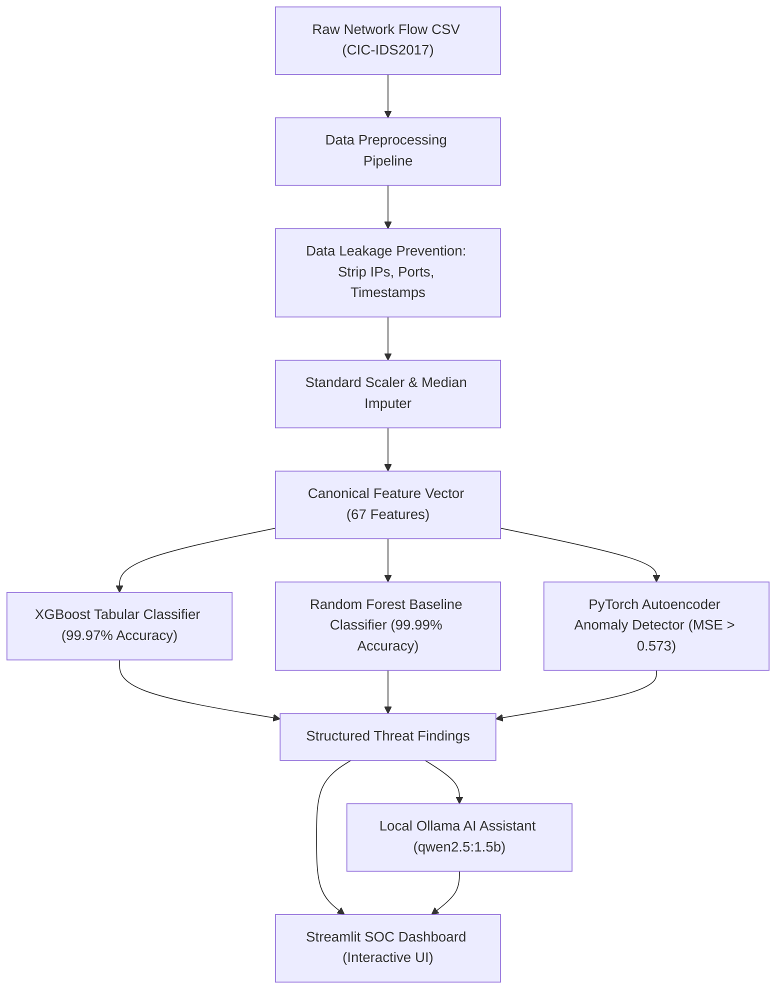

# CYBERSENTINEL: COMPLETE PROJECT STUDY & PRESENTATION GUIDE
### How CyberSentinel Works, How to Read the Network CSV, and How to Defend Your Project

---

## 1. THE BIG PICTURE: WHAT IS CYBERSENTINEL?

Imagine you own a high-security office building. Hundreds of people walk through the entrance every minute. 
A security guard cannot open every single briefcase and read every personal letter—that would take too long and invade people's privacy. 
Instead, the guard observes **behavior**:
- Is someone running aggressively through the doors?
- Is someone trying to pick every single lock in the hallway?
- Is one person trying 500 different keycards at the front door within 10 seconds?

**CyberSentinel does the exact same thing for computer networks.**
It is an AI-powered **Network Intrusion Detection System (NIDS)**. It does **NOT** read the private text of emails or WhatsApp messages. Instead, it inspects **"Network Flows"**—the mathematical metadata of connections:
- How long did the connection last?
- How many packets were sent and received?
- What was the packet transfer speed?
- Which port (door) was contacted?

Crucially, CyberSentinel is engineered for **Edge AI**: it runs on low-power, compact devices like the **NVIDIA Jetson Orin Nano (8GB)** as well as ordinary Windows laptops using a **single unified Python codebase**, operating **100% locally and offline** without cloud APIs.

---

## 2. HOW TO READ THE CSV WITH YOUR OWN EYES

When you open `demo_attack_traffic.csv` or any CIC-IDS2017 dataset file in Microsoft Excel or Notepad, you see **67 columns of numbers**. 
You don't need to memorize all 67 columns. **You only need to look at 5 KEY COLUMNS to spot the attack yourself!**

| Key CSV Column Name | What It Means in Real Life | What Value Indicates Danger? |
| :--- | :--- | :--- |
| **`Destination Port`** | Which "door" or service on the server is contacted. | `80/443` = Web, `21` = FTP Files, `22` = SSH Remote Shell. **Random changing ports** = Port Scanning! |
| **`Flow Duration`** | How long the conversation lasted (in microseconds: 1,000,000 µs = 1 second). | **Super tiny** (< 5,000 µs) in Port Scans. **Long and persistent** in DoS Hulk. |
| **`Total Fwd Packets`** | How many packets the requester/attacker sent. | **Enormous (50+)** in Floods; **Only 1 or 2** in Port Scans. |
| **`Total Backward Packets`** | How many response packets came back from the server. | If Fwd Packets is 50, but Bwd Packets is **0**, the server is overwhelmed and choking! |
| **`Flow Packets/s`** | Speed of sending (packets per second). | Normal human browsing is **1 to 50**. DDoS is **10,000 to 500,000+**! |
| **`SYN Flag Count`** | TCP handshake request ("Hello, let's connect"). | Normal traffic has 0 or 1. High rates indicate a SYN flood. |

---

## 3. THE 6 THREAT CATEGORIES & HOW TO SPOT THEM IN THE CSV

### A. BENIGN (Normal, Safe Traffic)
* **What it is:** A regular human browsing a website, checking email, or streaming audio.
* **How to see it in the CSV with your own eyes:**
  - `Destination Port`: Usually **80** (HTTP), **443** (HTTPS), or **53** (DNS).
  - `Flow Duration`: Moderate (e.g., 200,000 to 1,000,000 microseconds = 0.2 to 1 second).
  - `Total Fwd Packets` & `Total Backward Packets`: **Balanced!** (e.g., Fwd = 6, Bwd = 8). The client asks for a webpage, and the server sends data back.
  - `Flow Packets/s`: Low, human speed (e.g., 5 to 50 pkts/sec).

---

### B. DDoS (Distributed Denial of Service)
* **What it is:** An attacker uses thousands of bots to bombard a website with millions of fake packets until the server runs out of memory and crashes for real users.
* **How to see it in the CSV with your own eyes:**
  - `Destination Port`: **80** or **443** (targeting the web server).
  - `Flow Packets/s`: **EXTREMELY HIGH!** (Thousands or tens of thousands of packets per second).
  - `Total Fwd Packets`: High (e.g., 30 to 80+).
  - `Total Backward Packets`: **Almost ZERO!** (The server is suffocating and unable to answer).
  - `Packet Length`: Tiny and uniform (e.g., all packets are identical 40-byte or 60-byte ping packets).
  - `SYN Flag Count`: `1` (SYN flood).

---

### C. DoS Hulk (Application HTTP Flood)
* **What it is:** Hulk (*HTTP Unbearable Load King*) sends endless unique HTTP GET requests designed to bypass caching servers and exhaust the web server's processing threads.
* **How to see it in the CSV with your own eyes:**
  - `Destination Port`: **80** (HTTP).
  - `Flow Duration`: Long and persistent (e.g., 1,000,000+ microseconds).
  - `Total Length of Fwd Packets`: Very high (constantly pushing HTTP request strings).
  - `Flow IAT Mean` (Inter-Arrival Time): Very small (packets arrive in continuous bursts).

---

### D. PortScan (Reconnaissance / Burglar Probing)
* **What it is:** Before attacking, a hacker sends single probe packets to every port (door) on your computer to see which ones are open and vulnerable.
* **How to see it in the CSV with your own eyes:**
  - `Destination Port`: **WILD AND RANDOM!** Look at rows next to each other in Excel:
    - Row 1: Port `135`
    - Row 2: Port `445`
    - Row 3: Port `3389`
    - Row 4: Port `8080`
    - Row 5: Port `29412`
  - `Total Fwd Packets`: **EXACTLY 1, 2, or 3 packets!** The attacker just knocks once to see if anyone is home, then moves on immediately.
  - `Total Backward Packets`: `0` or `1`.
  - `Flow Duration`: **Tiny!** (e.g., 50 to 2,000 microseconds).
  - `SYN Flag Count`: `1`. `RST Flag Count`: High (the server rejects the unopened port).

---

### E. FTP-Patator & SSH-Patator (Brute-Force Password Guessing)
* **What it is:** An automated script trying 10,000 passwords a minute against an FTP or SSH server to guess login credentials.
* **How to see it in the CSV with your own eyes:**
  - `Destination Port`: **ALWAYS Port 21** (for FTP-Patator) or **ALWAYS Port 22** (for SSH-Patator).
  - `Flow Duration`: Moderate, repeating over and over in identical rapid bursts.
  - `Packet Length`: Uniform, identical sizes corresponding to the password attempt strings.

---

### F. ANOMALY (PyTorch Autoencoder Detection)
* **What it is:** A zero-day attack or unusual activity that has never been seen before.
* **How to spot it:** The Deep Learning Autoencoder compresses the flow into a 16-number bottleneck and reconstructs it. If the Reconstruction Mean Squared Error (MSE) is greater than **0.573**, it is flagged as an anomaly.

---

## 4. REAL ROW COMPARISON: HOW TO SPOT ATTACKS SIDE-BY-SIDE

| Traffic Type | Destination Port | Flow Duration | Fwd Packets | Bwd Packets | Flow Packets/s | SYN Flag | Why the AI Flags It |
| :--- | :---: | :---: | :---: | :---: | :---: | :---: | :--- |
| **BENIGN (Safe)** | `443` (Web) | 500,000 µs | 5 | 8 | 15 pkts/sec | 0 | Balanced request/response, normal speed. |
| **DDoS (Attack)** | `80` (Web) | 60,000 µs | 55 | **0** | **18,500 pkts/s** | **1** | Huge packet flood, zero response packets. |
| **PortScan (Attack)** | `41,920` (Random) | **850 µs** | **1** | **0** | 1,170 pkts/s | **1** | Single-packet probe on a random high port. |
| **FTP-Patator (Attack)**| `21` (FTP) | 38,000 µs | 14 | 16 | 320 pkts/s | 0 | Repetitive credential handshake on port 21. |

---

## 5. HOW THE PROJECT WORKS UNDER THE HOOD

---

## 6. PAGE-BY-PAGE DASHBOARD DEMONSTRATION SCRIPT

### 🖥️ Page 1: Overview
- **What it is:** The executive Security Operations Center (SOC) summary.
- **What to say:** *"This page provides a top-level summary of total analyzed records, benign traffic percentages, and detected threat categories. It also shows our live hardware telemetry in the sidebar."*

### 📂 Page 2: Dataset Analysis
- **What it is:** Ingestion, data hygiene, and schema validation.
- **What to do:** Choose `demo_attack_traffic.csv` and click *"Load Selected Dataset"*.
- **What to say:** *"Here, we validate incoming CSVs. We enforce strict Data Leakage Prevention by removing non-predictive identifying fields like IP addresses and timestamps so the AI learns packet physics instead of memorizing specific machines."*

### ⚡ Page 3: Threat Detection
- **What it is:** The primary live inference engine.
- **What to do:** Select **XGBoost** and click **"🚀 Analyze Traffic Records"**.
- **What to say:** *"In less than a second, XGBoost scans 1,500 records, separates benign traffic from DDoS and PortScan attacks, provides interactive donut charts, and displays actionable incident triage steps."*

### 📊 Page 4: Model Performance
- **What it is:** Experimental verification and metrics.
- **What to say:** *"We benchmarked Random Forest, XGBoost, and the PyTorch Autoencoder. XGBoost achieves 99.97% accuracy with a latency of just 4.67 ms per 1,000 flows. The confusion matrices prove false positives are below 0.05%."*

### 🤖 Page 5: AI Security Assistant
- **What it is:** Conversational cybersecurity intelligence.
- **What to do:** Click *"Explain DDoS in simple terms"* or *"Admin Investigation Steps"*.
- **What to say:** *"Junior analysts often don't know how to triage alerts. Our assistant translates raw telemetry into plain English without sending sensitive logs to external cloud APIs."*

### 💻 Page 6: Edge Device Performance
- **What it is:** Hardware telemetry and memory budgeting.
- **What to say:** *"On an 8GB NVIDIA Jetson Orin Nano, memory is shared. CyberSentinel stays under 4.0 GB of peak RAM usage, leaving 4.0 GB of safety headroom to prevent out-of-memory kernel locks."*

---

## 7. FILES CREATED FOR YOUR READING

1. **Microsoft Word Document:**
   [CYBERSENTINEL_COMPLETE_STUDY_GUIDE.docx](file:///c:/Users/ARPIT%20NAINWAL/OneDrive/Desktop/ECHS/CYBERSENTINEL_COMPLETE_STUDY_GUIDE.docx)
   *(Double-click to open in Microsoft Word, format prints cleanly, or transfer to your phone/tablet)*
2. **Markdown Study Guide:**
   [CYBERSENTINEL_COMPLETE_STUDY_GUIDE.md](file:///c:/Users/ARPIT%20NAINWAL/OneDrive/Desktop/ECHS/CYBERSENTINEL_COMPLETE_STUDY_GUIDE.md)
   *(Read directly in your editor or browser)*
