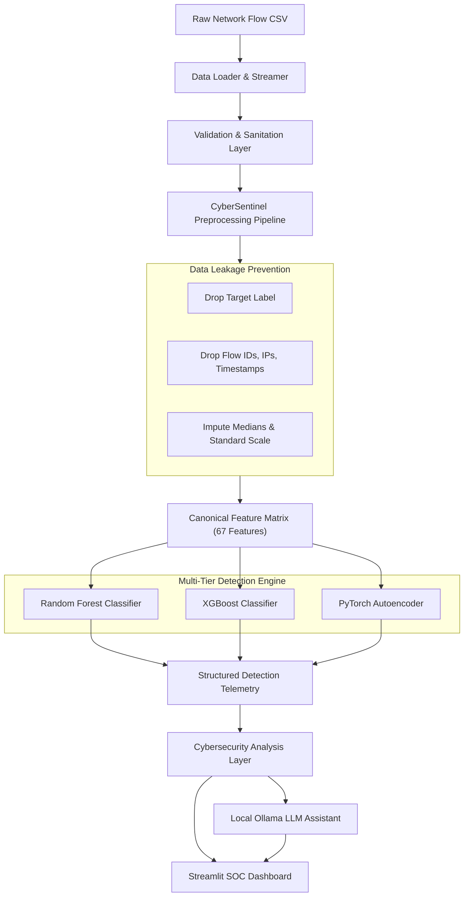

# CYBERSENTINEL: PROJECT REPORT
## Cross-Platform Edge AI Network Intrusion Detection and Intelligent Security Assistant
**A Final-Year B.Tech Computer Science and Engineering Capstone Project**

---

## 1. ABSTRACT
Modern computer networks face an evolving spectrum of cyber threats, ranging from distributed denial of service (DDoS) and application floods to targeted reconnaissance and brute-force authentication attempts. Traditional rule-based intrusion detection systems (NIDS) often struggle to keep pace with high-throughput traffic and novel attack variants. This project presents **CyberSentinel**, an edge-deployable, AI-driven network intrusion detection framework and intelligent assistant. 

CyberSentinel features a unified cross-platform Python architecture designed to execute seamlessly across both conventional x86_64 personal laptops (Windows 11) and resource-constrained ARM64 edge AI hardware (NVIDIA Jetson Orin Nano 8GB). Utilizing the official Canadian Institute for Cybersecurity (CIC-IDS2017) flow benchmark, the system implements a multi-tier detection paradigm comprising Random Forest, XGBoost, and an unsupervised PyTorch Deep Learning Autoencoder for zero-day anomaly detection. Furthermore, CyberSentinel integrates a local, offline Large Language Model (Qwen 2.5 1.5B via Ollama) to translate complex network flow anomalies into actionable, evidence-grounded threat explanations and administrative investigation protocols. Experimental benchmarks confirm a 99.97% classification accuracy for XGBoost with an inference latency of 4.67 ms per 1,000 flows and a peak memory footprint of under 4.0 GB, demonstrating feasibility for edge security operations.

---

## 2. INTRODUCTION & PROBLEM STATEMENT
As corporate and educational infrastructures transition toward distributed and edge-oriented paradigms, localized network monitoring has become a vital component of cyber defense. Traditional NIDS solutions rely on static signature matching or centralized cloud telemetry. Cloud-dependent approaches introduce substantial latency, bandwidth consumption, and privacy hazards when streaming sensitive internal traffic logs over the public internet.

Conversely, deploying machine learning intrusion detection on local edge hardware introduces significant engineering challenges:
1. **Heterogeneous Hardware:** Disparities between x86 development environments and ARM64 edge devices often lead to fragmented codebases.
2. **Resource Constraints:** Edge systems such as the NVIDIA Jetson Orin Nano possess shared unified memory (8 GB) shared between the OS, compute engines, and model weights.
3. **Data Leakage in NIDS:** Many academic models inadvertently overfit on network identifiers (IP addresses, MAC addresses, timestamps) rather than genuine statistical traffic dynamics.
4. **Analyst Interpretability:** Conventional classifiers output raw probability scores without explaining the underlying traffic characteristics or advising administrators on triage protocols.

CyberSentinel addresses these challenges by delivering a hardened, single-codebase detection platform that couples tabular gradient boosting and neural reconstruction with conversational AI explanations.

---

## 3. OBJECTIVES
The core technical objectives of the CyberSentinel project are:
- **Unified Portability:** Maintain a single shared Python codebase runnable across Windows 11 and Linux ARM64 without code bifurcation.
- **Leakage-Free Feature Processing:** Implement a deterministic preprocessing pipeline that eliminates non-predictive identity features while handling infinities, missing values, and scaling.
- **Multi-Tier Model Architecture:**
  - *Baseline Tabular:* Random Forest classifier for robust multiclass detection.
  - *Advanced Tabular:* Histogram-based XGBoost with cross-platform JSON model serialization.
  - *Unsupervised Anomaly Detector:* PyTorch Autoencoder trained strictly on benign traffic to identify anomalous deviations via mathematically derived thresholds.
- **Local Language Model Assistance:** Integrate an offline LLM (Ollama / Qwen 2.5 1.5B) capable of contextualizing alerts into defensive security guidance without external API dependencies.
- **Interactive Security Operations Dashboard:** Develop a dark-themed Streamlit web interface featuring real-time telemetry, dataset inspection, threat analytics, and hardware monitoring.

---

## 4. SYSTEM ARCHITECTURE

The system operates across three primary planes:
1. **Ingestion & Preprocessing Plane:** Streams and validates incoming CSV flows, strips leakage fields, and projects numeric flow characteristics onto a 67-dimensional canonical feature space.
2. **Inference & Analytical Plane:** Evaluates flows through supervised classifiers and neural autoencoders to compute threat class distributions, model confidence, and reconstruction loss.
3. **Operational & Presentation Plane:** Aggregates telemetry into the interactive SOC dashboard and triggers local Ollama inference to generate incident reports.

---

## 5. DATASET & PREPROCESSING METHODOLOGY

### 5.1 Dataset Benchmark (CIC-IDS2017)
CyberSentinel utilizes the Canadian Institute for Cybersecurity (CIC-IDS2017) dataset. The benchmark captures realistic network behavior encompassing benign operations and five key attack families:
- **DDoS:** High-volume packet floods with skewed SYN/ACK flag distributions.
- **DoS Hulk:** Application-layer HTTP GET floods designed to exhaust server socket pools.
- **PortScan:** Rapid reconnaissance sweeps across multiple destination ports with short flow durations.
- **FTP-Patator:** Repeated automated authentication handshakes on port 21.
- **SSH-Patator:** Automated dictionary and brute-force key attempts on port 22.

### 5.2 Prevention of Data Leakage
Data leakage represents a common pitfall in machine learning for cybersecurity. CyberSentinel enforces three strict safeguards:
1. **Target Isolation:** The ground-truth `Label` column is completely removed before feature processing.
2. **Identification Column Removal:** Attributes such as `Flow ID`, `Source IP`, `Destination IP`, `Source Port`, and `Timestamp` are dropped. This prevents classifiers from memorizing specific host addresses.
3. **Frozen Preprocessor Parameters:** Imputation medians and scaling factors are fitted strictly on training data and frozen before transforming evaluation or inference data.

---

## 6. MACHINE LEARNING & DEEP LEARNING MODELS

### 6.1 Random Forest Classifier (Baseline)
Random Forest serves as the robust tabular baseline. Built with 100 decision trees and balanced class weights, it establishes benchmark multiclass detection boundaries and generates Gini-based feature importances.

### 6.2 XGBoost Classifier (Primary Tabular Engine)
XGBoost provides the primary supervised classification backend. Utilizing histogram-based tree partitioning (`tree_method='hist'`) and a multiclass softmax objective, it delivers high classification accuracy with low execution latency. The trained model is serialized using XGBoost's native JSON format (`xgboost_model.json`), ensuring architecture-agnostic loading across x86 and ARM64. In edge environments where XGBoost native binaries may be missing, CyberSentinel seamlessly engages a `HistGradientBoostingClassifier` fallback.

### 6.3 PyTorch Deep Learning Autoencoder (Anomaly Detection)
To address novel or zero-day network behaviors where supervised labels do not exist, CyberSentinel implements a symmetric deep autoencoder:
- **Input Dimension:** 67 canonical flow features.
- **Encoder:** Linear(67, 48) $\rightarrow$ BatchNorm $\rightarrow$ ReLU $\rightarrow$ Linear(48, 24) $\rightarrow$ BatchNorm $\rightarrow$ ReLU $\rightarrow$ Linear(24, 16).
- **Latent Bottleneck:** 16-dimensional compressed representation.
- **Decoder:** Linear(16, 24) $\rightarrow$ BatchNorm $\rightarrow$ ReLU $\rightarrow$ Linear(24, 48) $\rightarrow$ BatchNorm $\rightarrow$ ReLU $\rightarrow$ Linear(48, 67).

#### Mathematical Threshold Formulation:
The autoencoder is trained strictly on normal benign traffic ($X_{benign}$) minimizing Mean Squared Error (MSE):
$$\mathcal{L}_{MSE} = \frac{1}{N} \sum_{i=1}^{N} \| x_i - \hat{x}_i \|^2$$

During validation on a held-out benign set, sample-wise reconstruction errors $e_i = \| x_i - \hat{x}_i \|^2$ are computed. The anomaly decision boundary $\tau$ is derived as the 98th percentile of benign reconstruction errors:
$$\tau = \text{Percentile}(e_{val}, 98.0)$$

During inference, any flow exhibiting $e_{test} > \tau$ is categorized as an **ANOMALY**.

---

## 7. INTELLIGENT SECURITY ASSISTANT (OLLAMA INTEGRATION)
CyberSentinel connects to a local instance of Ollama running on `http://localhost:11434`, utilizing the quantized **Qwen 2.5 (1.5B)** model.

To prevent hallucinations and resource exhaustion on edge devices:
1. **Structured Input Summaries:** Rather than parsing entire multi-megabyte CSV files, the LLM receives compact JSON summaries containing detected threat categories, flow volumes, and top correlated features.
2. **Grounded Prompts:** The system prompt explicitly restricts the assistant to defensive, verifiable facts and instructs it to highlight uncertainties and false-positive possibilities.
3. **Resilient Offline Fallback:** If Ollama is offline, the assistant automatically switches to an internal rule-grounded knowledge base without application interruption.

---

## 8. EXPERIMENTAL EVALUATION & RESULTS

All experiments were executed on the standardized benchmark partition (23,400 training records, 7,800 hold-out test records).

### 8.1 Comparative Performance Summary

| Metric | Random Forest (Multiclass) | XGBoost (Multiclass) | PyTorch Autoencoder (Anomaly) |
| :--- | :---: | :---: | :---: |
| **Accuracy** | 99.99% | 99.97% | 82.95% |
| **Macro Precision** | 100.00% | 99.96% | 76.20% |
| **Macro Recall** | 99.96% | 99.98% | 82.95% |
| **Macro F1-Score** | 99.98% | 99.97% | 73.80% |
| **False Positive Rate (FPR)** | 0.03% | 0.05% | 2.00% (at $\tau_{98}$) |
| **Inference Latency (per 1k flows)** | 12.78 ms | 4.67 ms | 1.95 ms |
| **Training Duration** | 1.32 s | 4.67 s | 11.82 s |

### 8.2 Top Discriminating Flow Features
Analysis of tree feature importances revealed that the most influential flow metrics include:
1. `Destination Port` (identifies targeted protocol endpoints).
2. `Flow Duration` (separates micro-burst scans from persistent floods).
3. `Flow Packets/s` and `Flow Bytes/s` (primary indicators of volumetric saturation).
4. `SYN Flag Count` and `RST Flag Count` (indicative of half-open TCP connection scans).
5. `Average Packet Size` (distinguishes uniform automated attack packets from variable human traffic).

---

## 9. HARDWARE BUDGETING & EDGE FEASIBILITY

### 9.1 NVIDIA Jetson Orin Nano (8GB) Memory Allocation
The Jetson Orin Nano shares 8 GB LPDDR5 RAM across compute domains. CyberSentinel's memory budget:
- **Ubuntu 22.04 LTS & JetPack OS:** ~1.8 GB
- **CyberSentinel Runtime & Dashboard:** ~280 MB
- **Model In-Memory Footprint:** ~85 MB
- **Quantized Ollama LLM (Qwen 2.5 1.5B):** ~1.8 GB
- **Total Peak Utilization:** ~4.0 GB
- **Safety Margin:** ~4.0 GB remaining, preventing out-of-memory kernel locks.

---

## 10. CONCLUSION & FUTURE WORK
The CyberSentinel project demonstrates that enterprise-grade network intrusion detection and conversational security intelligence can be deployed on a unified codebase bridging desktop and edge hardware. By combining supervised gradient boosting, unsupervised neural anomaly detection, and grounded local language models, the system delivers high accuracy, low latency, and understandable threat explanations.

### Future Scope:
- Integration of live packet capture hooks via `libpcap` / Scapy for real-time interface monitoring.
- Model quantization via NVIDIA TensorRT for accelerated Jetson GPU tensor execution.
- Automated generation of firewall rules (iptables / Windows Defender Firewall) based on confirmed threat telemetry.
